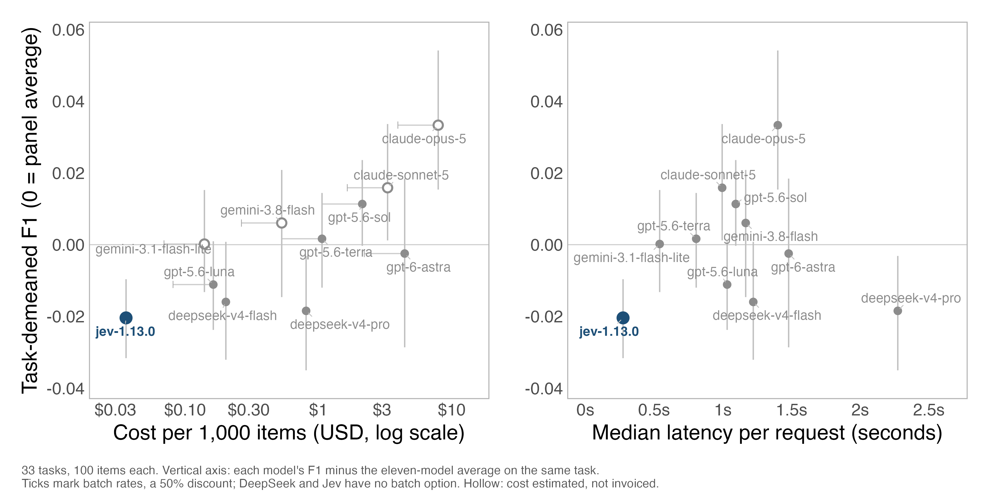
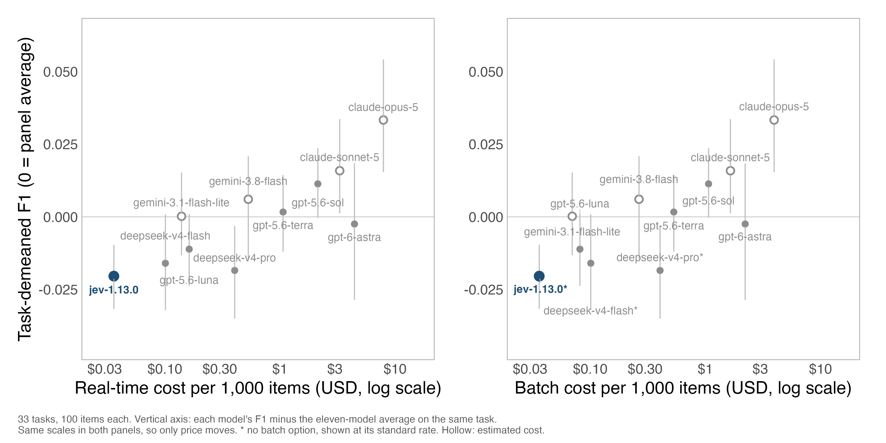

# polsci-open-bench

A benchmark of local open-weight and commercial API language models for
political science text classification.

The main release compares six local Ollama models with four commercial API
models on 33 classification tasks drawn from political science papers,
replication archives and documented public datasets. The
[report](output/report_pdf.pdf) is the authoritative summary.

The repository holds two sets of results. They use different models, items and
scoring rules for unusable output, so their numbers are not directly comparable.

| | Main release | September 2026 panel |
|---|---|---|
| Models | 6 local (Ollama on an Apple M2 Pro) and 4 API | 20 open-weight (vLLM, one or two GPUs) and 11 API |
| Tasks and items | 33 tasks, 293 to 500 items each | the same 33 tasks, 100 frozen items each |
| Unusable output | excluded from F1 and reported as a rate | scored as wrong |
| Written up in | [report](output/report_pdf.pdf), section "Main Result" below | [results page](https://www.hannohilbig.com/llm-benchmark/), section "Matched Model Comparison" below |
| Data | [`output/summary.csv`](output/summary.csv), [`output/predictions.csv`](output/predictions.csv) | [`output/sidecar/refresh_20260910_release_33/`](output/sidecar/refresh_20260910_release_33) (summary tables only) |

Main-release models: `gemma4:26b`, `gemma4:31b-it-q4_K_M`, `qwen3:14b-q4_K_M`,
`qwen3.5:35b-a3b-q4_K_M`, `qwen3:30b-a3b-q4_K_M`,
`mistral-small:24b-instruct-2501-q4_K_M`, `gpt-5.5`, `gpt-5.4-nano`,
`claude-sonnet-4-6` and `deepseek-v4-pro`. The manifests are in [`models/`](models).

**Start here.** To read results, open the report or the results page. To check
that the code runs on your machine without spending anything, use the no-cost
smoke test under [Reproduce](#reproduce). To score your own task or model, see
[`docs/custom_tasks.md`](docs/custom_tasks.md) and
[`docs/custom_models.md`](docs/custom_models.md).

## Main Result

Local open-weight models are often competitive with commercial API models, and
no single model ranks first across tasks. The best local model matches or
exceeds the best API model on 9 of 33 tasks. On average, the best API model
leads by 0.013 F1, with its clearest advantage on tasks that have many active
labels, long codebooks or several outputs per item. On average, every model
scores well above chance: always predicting the most common label averages 0.154
F1 across the 33 tasks, and guessing at the rate of each gold label averages
0.253, against 0.713 for the best model on each task. One task is an exception. On
`bestvater_wm_stance`, 85% of items are positive, so always answering yes scores
0.918, above every model ([`output/chance_baselines.csv`](output/chance_baselines.csv)).

Two further experiments test whether this gap is an artifact of the benchmark.
The published run gave API models server-side JSON-schema enforcement and local
models none. Running four open-weight models twice over the same 16,425 items,
once with schema-constrained decoding and once without, moves mean F1 by 0.0014,
an order of magnitude less than the gap. Output constraint therefore does not
explain the difference between the two groups. These four were vLLM checkpoints
on a GPU cluster, not the Ollama models of the main release, and the test does
not address other differences between the groups, such as reasoning settings.
The item-level predictions are in
[`output/sidecar/schema_parity_20260918/`](output/sidecar/schema_parity_20260918),
and `code/build_schema_parity.py` recomputes the result from them.

The second experiment asks how many hand-coded labels a supervised classifier
needs to match zero-shot coding. Logistic regression on frozen multilingual-E5
embeddings, trained on 2,000 labels per task, reaches 0.672 mean F1 on 30 tasks.
With no labels at all, the best single local model, Gemma 4 31B, reaches 0.679
on the same tasks, and choosing the best local model separately for each task
reaches 0.697. The learning curve gained 0.012 over the last doubling of labels,
so the crossover lies in the low thousands of labels per task.

Researchers should test candidate models on labeled examples from their own task
and report both performance and the rate of unusable output.

## Matched Model Comparison, September 2026

A second panel runs 31 models, 11 commercial APIs and 20 open-weight
checkpoints, on the same 33 tasks with 100 frozen items per task. Every model
codes the same 3,300 texts under the same prompts and scorer, with one
exception: Jev 1.13, a model from TypeSafe that answers by choosing among fixed
options, receives the prompt inside its provider's choice format. Open-weight
models ran at temperature 0, while most API models ran at their provider's
default temperature, and each model coded each text once. The results are
at [hannohilbig.com/llm-benchmark](https://www.hannohilbig.com/llm-benchmark/),
and the release data are in
[`output/sidecar/refresh_20260910_release_33/`](output/sidecar/refresh_20260910_release_33).

Claude Opus 5 has the highest mean task F1 at 0.714. The best open-weight models
are Qwen3.8 Flash-Next at 0.675, which needs two GPUs, and Llama 3.1 70B in FP8
at 0.675 on one GPU. Both trail Opus by 0.039 F1, a gap whose paired intervals
exclude zero, and both score above four of the eleven API models (GPT-5.6 Luna,
both DeepSeek models and Jev 1.13). Of those eight comparisons, only Flash-Next's
lead over Jev is distinguishable from zero. Task by task, Llama 3.1 70B matches
or beats Claude Opus 5 on 9 of 33 tasks. Taking the best of the 19 single-GPU
open models on each task raises that count to 14, but picking the maximum of 19
noisy scores per task favours the open side.

The panel also measures what each API model costs and how long a request takes.



Among the API models, mean task F1 ranges from 0.661 for Jev 1.13 to 0.714 for
Claude Opus 5. On a paired task bootstrap, six of the ten other API models
outperform Jev: both Claude models, both Gemini Flash models and two GPT-5.6
models. The remaining four are indistinguishable from it. Jev is the cheapest
and fastest API model.
The cheapest model that outperforms it is Gemini 3.1 Flash-Lite, which costs
about four times as much per item and takes twice as long per request, for a gain
of 0.021 F1.



OpenAI, Anthropic and Google discount batch requests by 50%, while DeepSeek and
Jev offer no batch option. At batch rates, Flash-Lite costs about twice as much
as Jev.

Prompt optimisation does not close the gap for Jev. GEPA, run on 30 tasks with
prompts selected on rows the benchmark never sampled, raises held-out F1 by
0.011, with a paired interval that includes zero. The same prompts gained 0.048
on the rows used to select them, so 78% of the apparent improvement does not
carry over to new items.

Costs for the OpenAI, DeepSeek and Jev models come from provider billing
records. Costs for Gemini and Anthropic are token counts multiplied by published
prices, and the figures draw these models with hollow markers.

## Scope

- 33 active tasks in [`tasks/`](tasks), one held out (see [`CHANGELOG.md`](CHANGELOG.md))
- Main release: 6 local and 4 API models, 293 to 500 items per task
- September panel: 11 API and 20 open-weight models, 100 items per task
- Metrics: main F1 (`headline_f1` in the CSVs), accuracy, MCC, time per item and
  unusable-output rate
- Local hardware: Apple M2 Pro, 32 GB

## Outputs

- Predictions and summary: [`output/predictions.csv`](output/predictions.csv),
  [`output/summary.csv`](output/summary.csv)
- Prompt-batched runs: [`output/predictions_batched.csv`](output/predictions_batched.csv),
  [`output/summary_batched.csv`](output/summary_batched.csv)
- Supervised learning curves: [`output/supervised_baseline_e5.csv`](output/supervised_baseline_e5.csv)
- Chance baselines per task: [`output/chance_baselines.csv`](output/chance_baselines.csv)
- Constrained-decoding experiment: [`output/sidecar/schema_parity_20260918/`](output/sidecar/schema_parity_20260918)
- September panel tables: [`output/sidecar/jev_sidecar/`](output/sidecar/jev_sidecar)
- GEPA results, including each optimised prompt: [`output/sidecar/gepa_jev_20260920/`](output/sidecar/gepa_jev_20260920)

## Reproduce

```bash
python3 -m venv .venv && source .venv/bin/activate
python3 -m pip install -r requirements.txt
python3 code/task_inventory.py --check
python3 -m unittest discover -s tests
```

On a fresh clone the test suite takes a few minutes and skips about 65 tests.
Those tests check figures built from per-request outputs under `output/sidecar/`
that are not in the repository, and each skip names the missing file.

No-cost smoke test. It runs a two-item example task against a local stub server
that imitates an OpenAI-compatible API, so it needs no API key, Ollama or GPU.
Start the stub in one terminal:

```bash
python3 examples/local_openai_stub_server.py --max-requests 4
```

Then, in a second terminal:

```bash
python3 code/benchmark.py \
  --task-dir examples/minimal_custom_task \
  --model-manifest examples/minimal_custom_models/local_openai_stub.yaml \
  --output /tmp/polsci-smoke/predictions.csv
python3 code/build_summary.py \
  --task-dir examples/minimal_custom_task \
  --model-manifest examples/minimal_custom_models/local_openai_stub.yaml \
  --predictions /tmp/polsci-smoke/predictions.csv \
  --output /tmp/polsci-smoke/summary.csv
```

Success means four prediction rows and one summary row with `headline_f1` 1.0.

Before a real run, `--dry-run` lists the tasks, item counts, models and number
of model calls without calling any model:

```bash
python3 code/benchmark.py --dry-run
```

A real run calls every API model whose key is set in the environment, and those
calls are billed by the provider. The runners refuse to overwrite the
checked-in `output/predictions.csv` or `output/predictions_batched.csv` unless
you pass `--overwrite-release`; use `--output` to write elsewhere.

Rebuild the report:

```bash
Rscript code/build_report_assets.R
quarto render output/report_pdf.qmd --to pdf
```

See [`docs/reproduce.md`](docs/reproduce.md) for setup, local model downloads
and rerun commands.

## Documentation

- [`docs/status.md`](docs/status.md): current release state
- [`docs/schema.md`](docs/schema.md): output schema
- [`docs/prompts_provenance.md`](docs/prompts_provenance.md): task and prompt provenance
- [`docs/task_source_fidelity_audit.md`](docs/task_source_fidelity_audit.md): source-fidelity audit
- [`docs/custom_tasks.md`](docs/custom_tasks.md), [`docs/custom_models.md`](docs/custom_models.md): adding tasks and models
- [`CHANGELOG.md`](CHANGELOG.md): changes to tasks, labels, prompts and metrics

## Layout

```text
code/         runners, analysis scripts and report builders
data/         cleaned task files
tasks/        task manifests (tasks_v2/ supersedes corrected v1 tasks)
prompts/      task prompts (prompts_v2/ belongs to tasks_v2/)
models/       model manifests
experiments/  run configurations for the side experiments
output/       predictions, summaries, figures and reports
docs/         documentation
tests/        unit tests
```

Raw per-request responses under `output/sidecar/` are not tracked, since they
run to tens of thousands of files. The derived tables the figure scripts read
are tracked, so the figures rebuild from a clone.

## Citation

Please cite the report and the source papers for the individual tasks, listed in
[`docs/prompts_provenance.md`](docs/prompts_provenance.md).
[`CITATION.cff`](CITATION.cff) holds the citation for this repository.

## License

Code is MIT licensed, see [`LICENSE`](LICENSE). Task CSVs derive from public
replication archives and documented public datasets, and each inherits the
license of its source.
